# AIONSour

Portable companion for **AION 2** (Windows): events and resets, keys and currencies, hidden cubes, gathering routes, a damage meter, field bosses, pets, daily and weekly tasks, set reminders, your arcana, duty missions and class skills. It only reads the game's traffic on your PC: it doesn't modify the game, never plays for you and doesn't send your data anywhere.

Available in **English and Spanish**.

**[⬇ Download AIONSour (ZIP)](https://github.com/JarekSour/AIONSour/archive/refs/heads/main.zip)**

## Installation

1. Install [Npcap](https://npcap.com) (needed to read the game's traffic).
2. [Download the ZIP](https://github.com/JarekSour/AIONSour/archive/refs/heads/main.zip) and extract it anywhere.
3. Open `AIONSour.exe`. Capture starts on its own.

It's a portable folder: nothing gets installed, and your data is stored inside it.

## Features

### Home

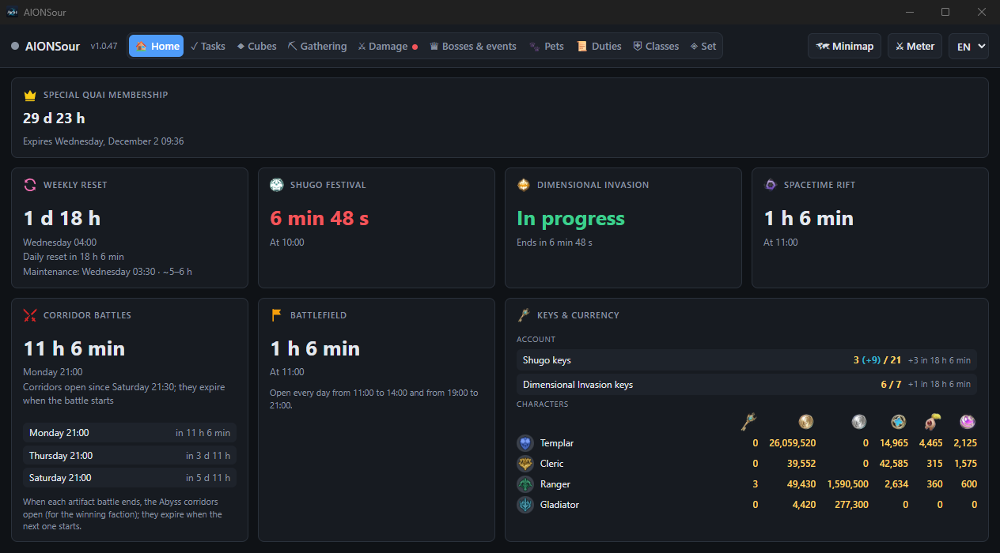

- **Special Quai Membership**: time left until it expires.
- Countdowns to the resets, weekly maintenance, Shugo Festival, Dimensional Invasion, Spacetime Rift, corridor battles and Battlefield.
- Who holds each Abyss artifact and when the corridors expire.
- Account keys and each character's cube keys and currencies.

### Tasks

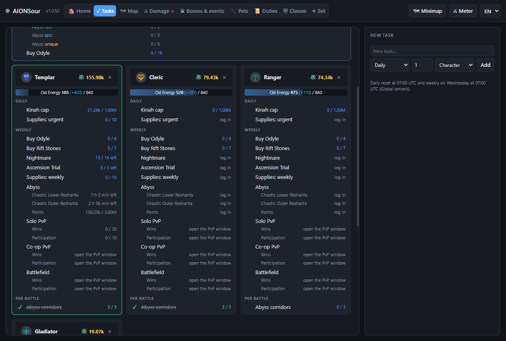

- Daily and weekly tasks **per character**, checked off on their own from game data: kinah cap, supplies, Nightmare, Ascension Trial, Abyss (Chaotic Lower and Outer Reshanta time, Abyss points), PvP and more.
- Account tasks: duty missions, attendance, gathering limit, Unknown Fissure and shop purchases.
- Each character's combat power and Od Energy, which keeps counting while offline.
- Add your own tasks, daily, weekly or per battle.

### Map

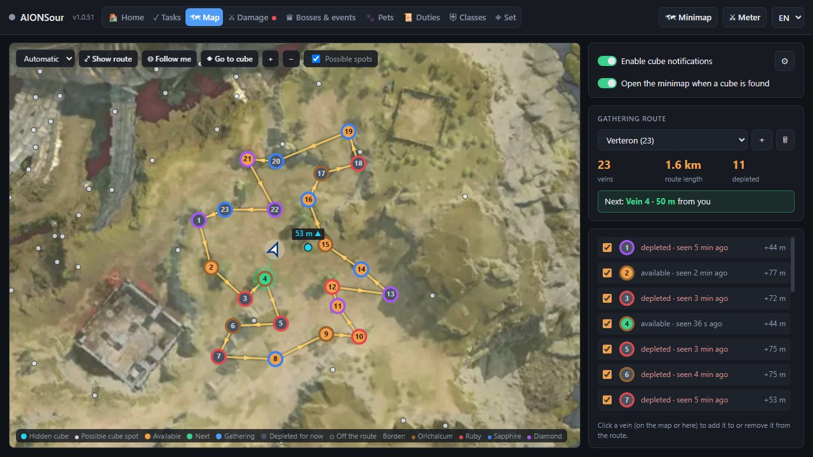

- Hidden cubes and gathering on one map, with your position and the distance to each cube.
- Detects hidden cubes, several at once, with a flash and sound; you can turn the cube notifications off.
- A cube can open the floating minimap on its own, which says who opened it and closes 5 s later.
- A cube nobody opens within a minute is forgotten.
- Saves every vein you gather (orichalcum, ruby, sapphire and diamond) and shows which ones are available and the next one.
- Create named routes, drawn as the shortest loop.
- Maps: Verteron, Altgard, and Chaotic Lower and Outer Reshanta.
- Turn on **Show the pets I'm missing** to see where the pets you don't have or haven't maxed drop, colored by family. Hover a dot to see the pet; click it to open its map.

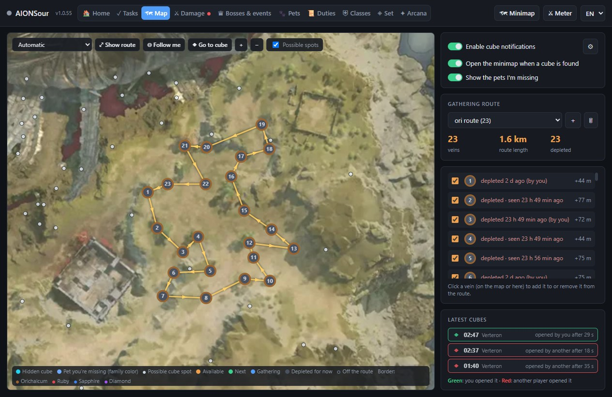

### Damage meter

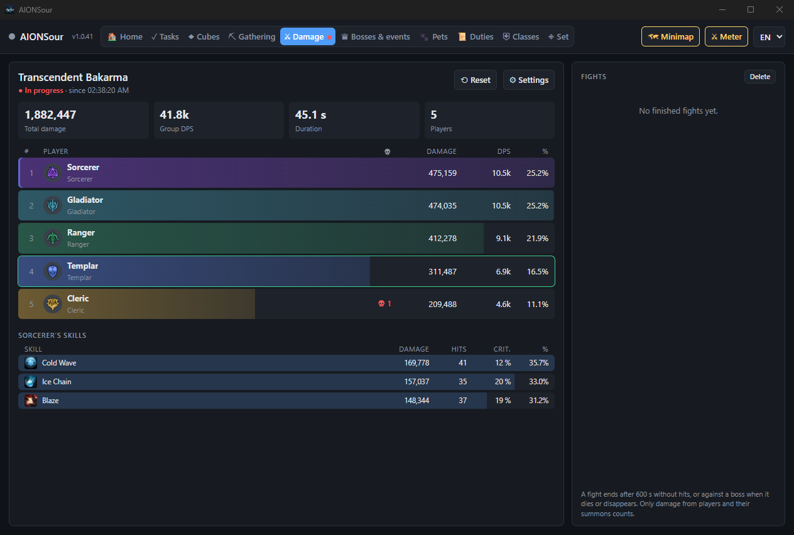

- Damage, DPS and share of each player, with class, combat power and deaths.
- Per-skill breakdown and history of the last 10 fights.
- Boss stagger: how much each player took off every stagger bar.

#### Healing

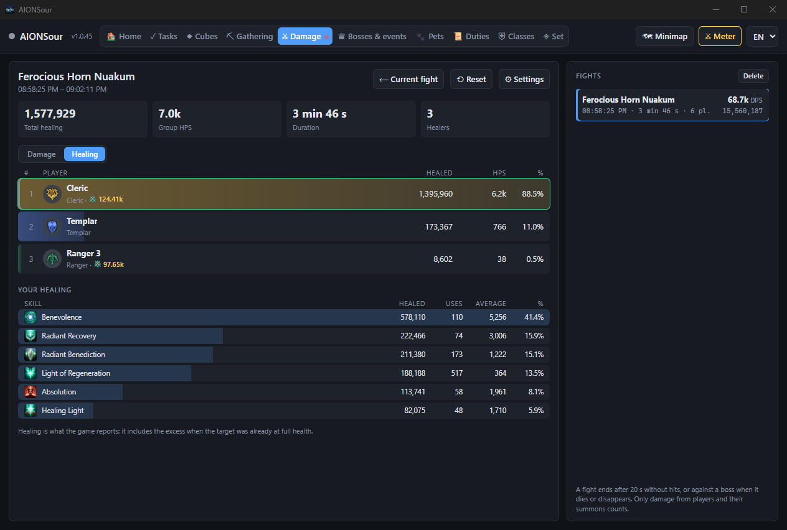

- Total healing, HPS and each healer's skills.

### Floating windows

| Minimap | Meter | Expedition group |
| --- | --- | --- |
| 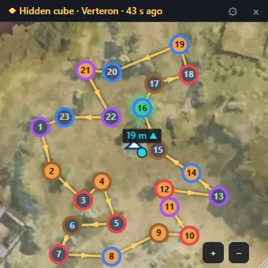 | 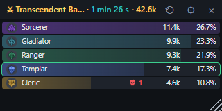 | 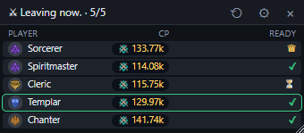 |

- **Minimap** and compact **damage meter** always on top of the game, each with its own settings.
- The minimap can show your gathering route, the pets you're missing, and follow you. Between the game's position updates it follows you by reading the game's own minimap on screen (read-only).
- The minimap opens instantly and stays out of the taskbar.
- The meter shows your expedition group, who's ready, and then the fight, with a box per boss stagger bar. Players joining or leaving show at once. After an expedition it shows who voted to enter again.
- Choose the meter's columns in its ⚙ (player and DPS always shown).

### Field bosses and events

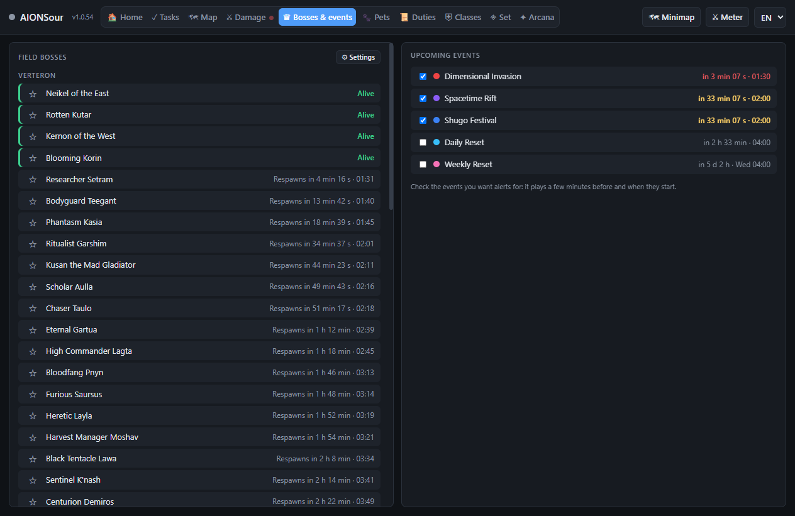

- Field boss status and respawn times, and upcoming events.
- Alerts for the ones you mark:

  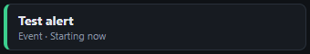

### Pets

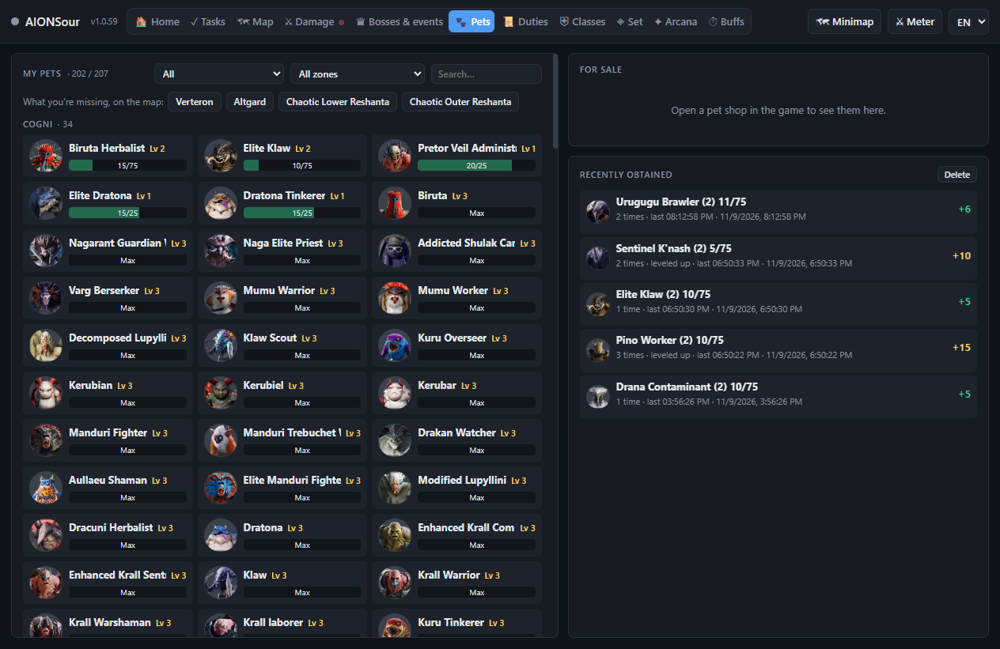

- Every pet by family, with your level and souls, and which ones to complete first.
- Pets for sale in the game's shops that you're missing.
- Filters and search, and a map of where each pet drops:

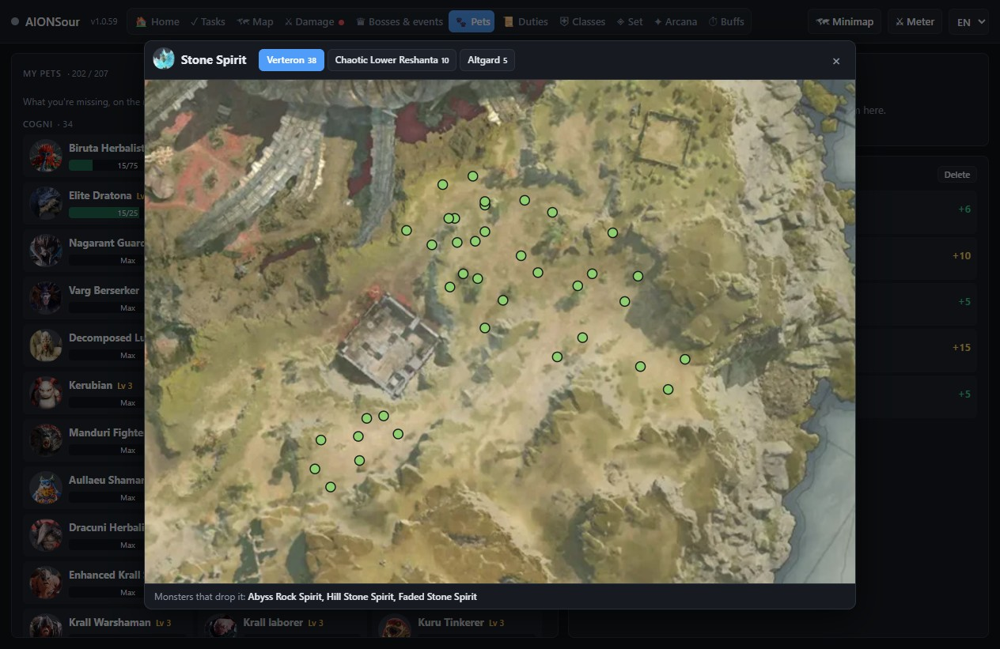

- What you're still missing in each zone (Verteron, Altgard, Chaotic Lower and Outer Reshanta), on the map:

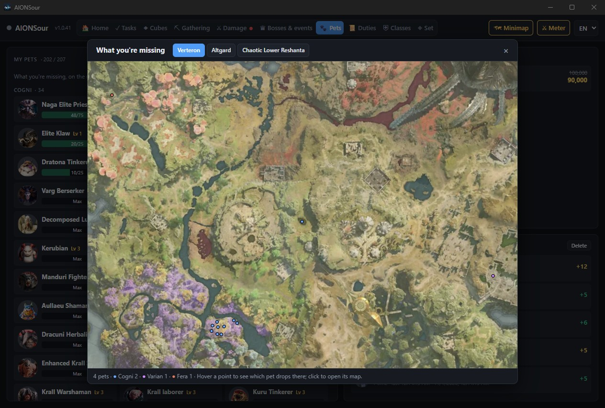

### Set

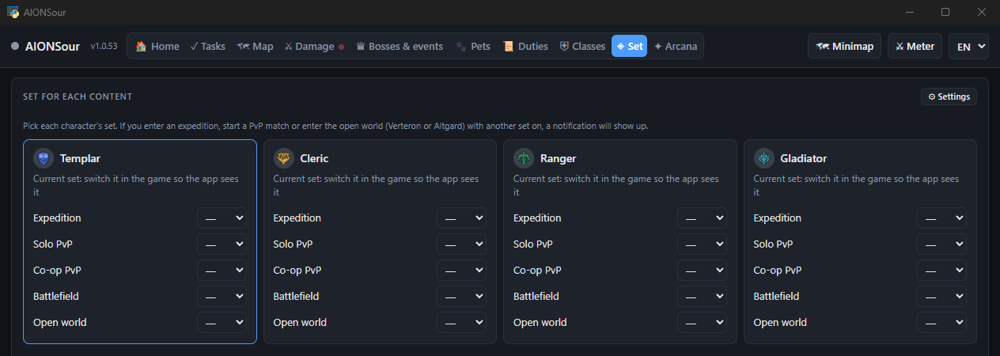

- Pick the set for each content (expeditions, PvP, Battlefield, open world) and get a reminder if you're wearing another one:

  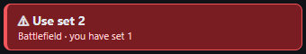

### Arcana

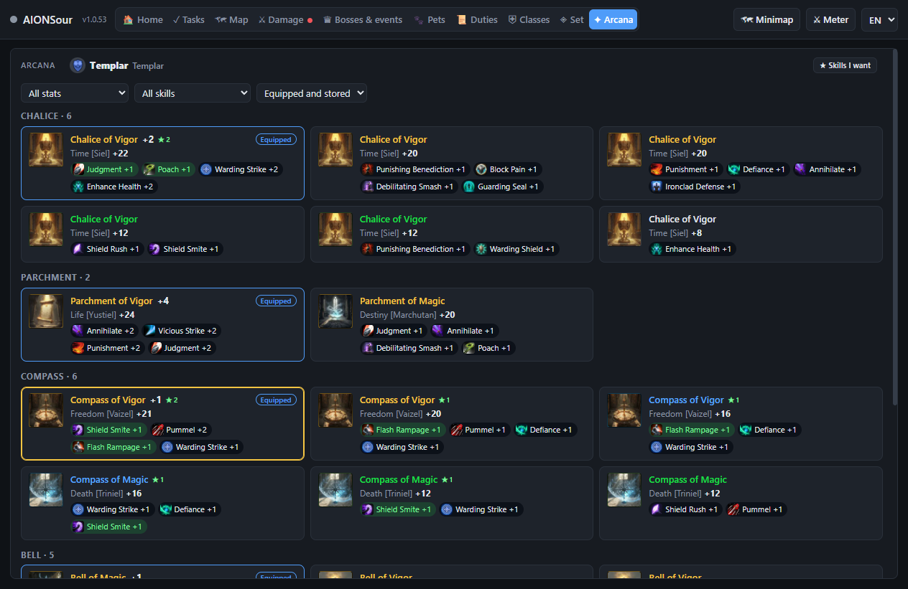

- Each character's arcana, equipped and stored, by type: grade, enhancement, Empyrean Lord stat and skill levels. They update when you get, enhance, equip or consume one.
- Filter by stat, by skill or by equipped and stored.
- Pick, for each card type, the family (Vigor or Magic) and the skills you want, from the ones that card can have: they're highlighted, and a card with all of them (and of that family) gets a gold border. The profile is per class, shared by your characters of that class.

### Duty missions

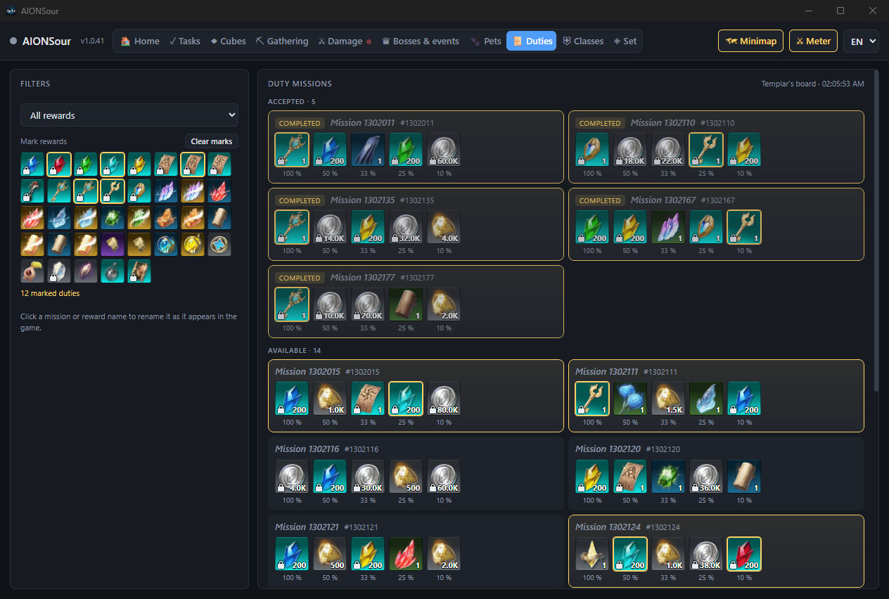

- Your duty board with each mission's rewards and chances.
- Filter by reward and highlight the ones you want.

### Classes

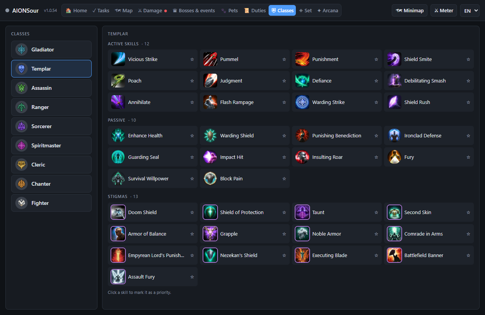

- All 9 classes with their skills and stigmas; star your priorities.

### Updates

- Checks for new versions and updates with one click, keeping your data.

## Notes

- No bots or automation: everything in the game is done by you.
- Fan project, not affiliated with NCSOFT.
