# AIONSour

Portable companion for **AION 2** (Windows): a home screen with upcoming events, keys and currencies, hidden cubes with your position on the map, a damage meter, field bosses and events, pets, daily and weekly tasks, a reminder to wear the right set in each content, duty missions with their rewards, and every class's skills. It reads the game's traffic on your PC; it doesn't modify the game or send your data anywhere.

Available in **English and Spanish**: it follows your Windows language the first time, and you can switch it at any time from the selector at the top right.

**[⬇ Download AIONSour (ZIP)](https://github.com/JarekSour/AIONSour/archive/refs/heads/main.zip)**

## Installation

1. Install [Npcap](https://npcap.com) (needed to read the game's traffic).
2. [Download the ZIP](https://github.com/JarekSour/AIONSour/archive/refs/heads/main.zip) and extract it anywhere.
3. Open `AIONSour.exe`. Capture starts on its own: it listens on all your network adapters (wired, Wi-Fi, VPN…), so there's nothing to choose.

It's a portable folder: nothing else gets installed, and your data (history, tasks, pets, settings) is stored inside it.

## Features

### Home

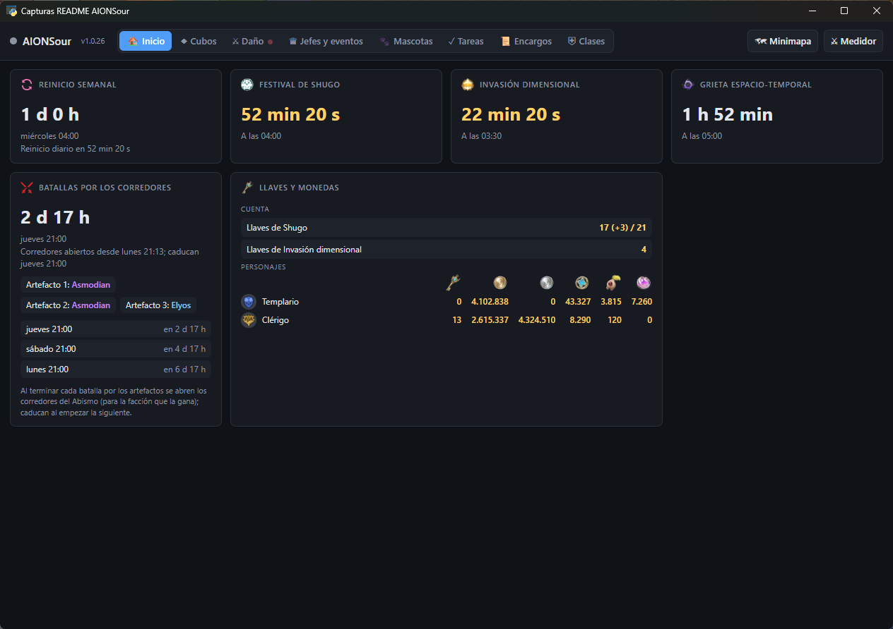

- Countdowns to the **weekly reset** (and the daily one), the **Shugo Festival**, the **Dimensional Invasion** and the **Spacetime Rift**, or how long they stay open. They turn yellow with less than 1 h left and red with less than 15 min.
- **Weekly maintenance**: when it starts (30 min before the weekly reset, about 5–6 h long); while it lasts, the card shows «Under maintenance» and its approximate end.
- **Corridor battles**: the upcoming artifact battles, since when the Abyss corridors are open and when they expire, and who holds each artifact (Elyos or Asmodian), read from the game.
- **Battlefield**: time until it opens (every day from 11:00 to 14:00 and from 19:00 to 21:00) or how long it stays open.
- **Keys and currency**: the account's Shugo and Dimensional Invasion keys, with their cap (21 and 7) and time to the next refill (+3 and +1 at each daily reset); per character, cube keys, kinah, bound kinah, Abyss points, centennial root tokens and dream fragments. Extra amounts are shown in parentheses in another color: «16 (+3) / 21».

### Tasks

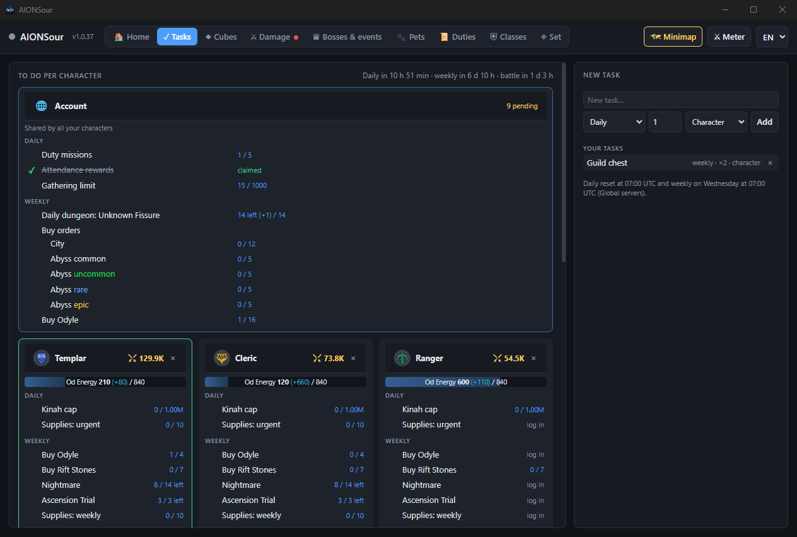

- Daily and weekly to-do list **per character**; characters are added on their own when you log in with them.
- **Automatic** tasks checked off from game data: kinah cap, supplies (urgent and weekly), Odyle and Rift Stone purchases, Nightmare, Ascension Trial, Abyss time and points… Until there's game data they say «log in to the game» and can't be ticked by hand.
- **Solo PvP, Co-op PvP and Battlefield**: the week's wins and participation (30 and 10; 3 and 3 on the Battlefield). They update on their own when you win or lose each match and when you open the game's PvP window.
- Extra entries («0 left (+2) / 3») are shown apart and don't leave the task pending.
- **Combat power** of each character on its card, abbreviated as in the game, and up to date when you change gear or character.
- **Per battle** section: the Abyss corridors open for your account and which ones each character did; they reset with each artifact battle.
- **Account** card at the top (🌐), with what all your characters share: duty missions (5 a day per account), attendance rewards, the daily gathering limit (1000 a day), Unknown Fissure entries (14 a week), order purchases (city: 12 a week; Abyss: common, uncommon, rare and epic, 5 a week each, colored by grade) and the weekly Odyle purchase (16 a week).
- Each character's Od Energy bar and its Odyle purchase (4 a week).
- **Your own tasks**: name, daily, weekly or per battle, number of times, and per character or per account. Click to add, right-click to subtract. The ones you created appear under «New task», with a button to delete them.
- Automatic daily and weekly reset at server time.

### Hidden cubes

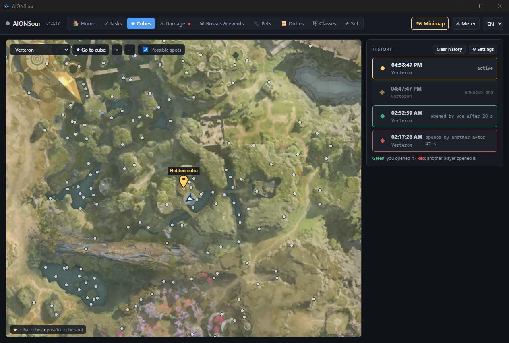

- Detects hidden cubes as they appear and marks them on the zone map (Verteron or Altgard), with all the possible spots where they can show up.
- History with the time and outcome of each one: **green** if you opened it, **red** if another player did, or replaced by a new one.
- Alert with sound when a cube appears: the app switches to the Cubes tab and flashes (configurable).
- **Your character** shows on the map as an arrow pointing the way you're moving, updated about once a second while you move. It's read from the game's traffic, like everything else: nothing is sent to the game.

### Damage meter

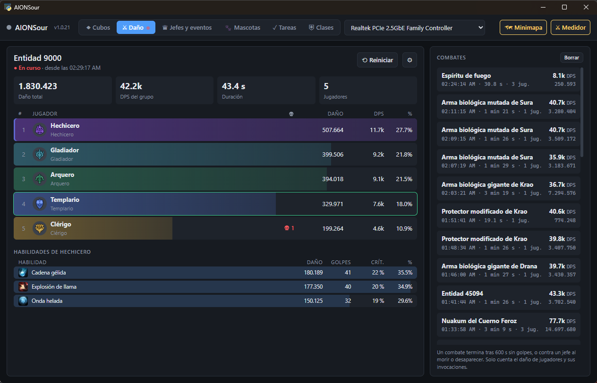

- Total damage, DPS and share of each group member, with their class, and the fight's deaths.
- Click a player for the per-skill breakdown: damage, hits and crits.
- Fight history with the boss or monster name, duration and number of players.
- Only damage from players and their summons counts; the fight ends when the boss dies or after a time without hits (configurable).
- Animated bars: they grow smoothly and, when a player overtakes another, their row slides up above it.

### Floating windows

| Minimap | Meter |
| --- | --- |
| 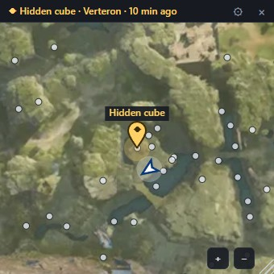 | 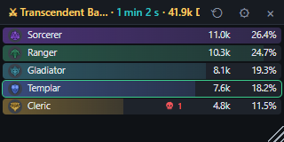 |

- **Minimap** with the active cube and your position, and a compact **damage meter**, always on top of the game.
- Each one has its ⚙: opacity, size and position. Open them with the buttons at the top right.

### Field bosses and events

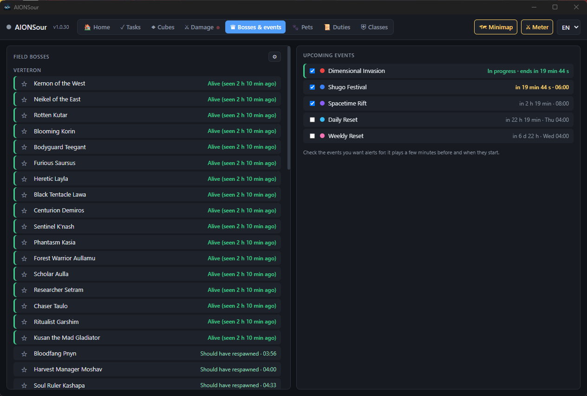

- Status of the field bosses in Verteron, Altgard and Chaotic Lower Reshanta: alive, or time until they respawn.
- Upcoming events for the Global version with countdowns: Dimensional Invasion, Spacetime Rift, Shugo Festival and the daily and weekly resets.
- Mark the ones you care about (☆ on bosses, checkbox on events) and you'll get an alert a few minutes before and when they start (it grows to fit long names and several alerts at once):

  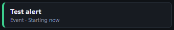

### Pets

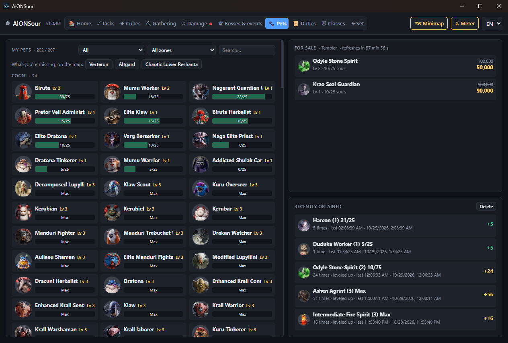

- Every pet in the game, by family (Cogni, Fera, Natura, Varian and Special), with its level and soul progress. Within each family: the ones to complete first (closest to max level at the top), then the maxed ones, and the ones you don't have yet, dimmed.
- **For sale**: the pets in the game's shops that you're missing or haven't maxed yet, with your level and souls, the normal price and the discounted one; what you buy shows as sold out. Read when you open the shop, until it refreshes (every hour); it shows whose shop it is, and opening it with another character replaces it.
- Latest souls obtained (the last 5 pets), with automatic level-ups.
- Filter by source (field, dungeons only, or shop/other) and by the zone where it appears. Search by name.
- Click a pet to see the **map with the spots where the monsters that drop it spawn**, by zone:

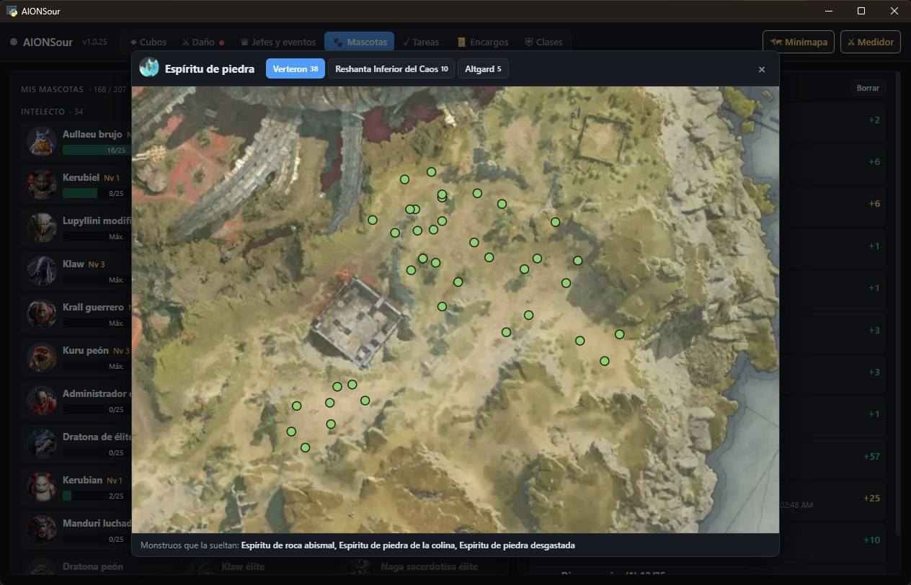

- **What you're missing, on the map**: in Verteron, Altgard and Chaotic Lower Reshanta, the spawn points of every pet you don't have or haven't maxed, colored by family. Hover a point to see which pets drop there, click it to open that pet's map:

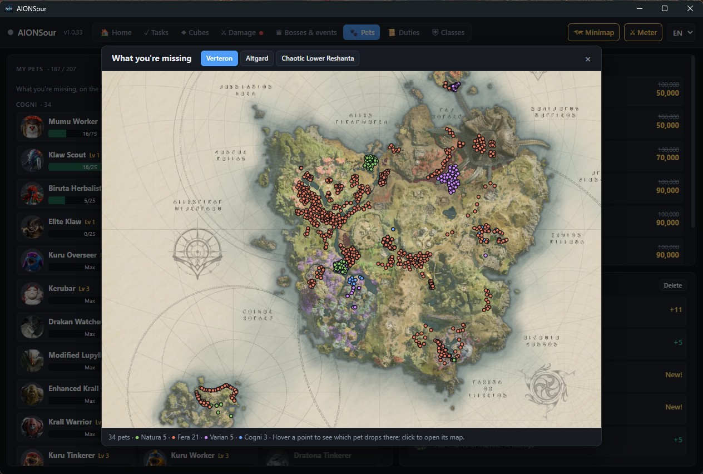

### Set

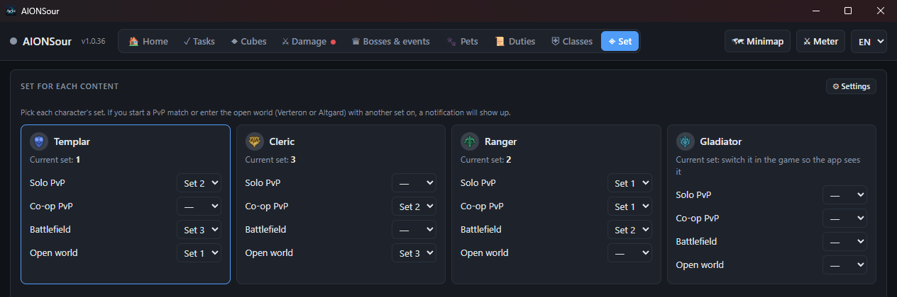

- Pick, for each character, the set to use in each content: **Solo PvP**, **Co-op PvP**, **Battlefield** and **open world** (Verteron and Altgard).
- If a PvP match starts, or you enter or teleport in the open world, with another set on, you get a red notification over the game, with its own sound:

  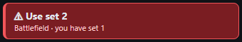

- Each card shows the set the character has on, read from the game when you switch sets. Its ⚙ **Settings** has the volume, screen and position of the notification (shared with the boss and event alerts) and a test button.

### Duty missions

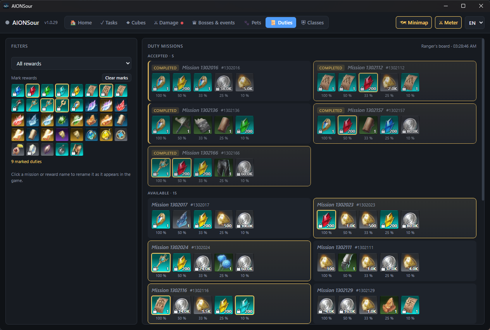

- Your account's duty board with each mission's **rewards**, as in the game: icon, abbreviated amount, a lock if bound, background by grade, and chance (100 %, 50 %, 33 %, 25 % and 10 %).
- **Accepted** ones apart at the top and **available** ones below, in the same order as the game. They update instantly when you accept, abandon, complete or refresh the list; accepted ones are kept when you refresh it and cleared at the daily reset. Missions you start with a purchased order aren't mixed with the board's.
- **Filter by reward**: pick an item and see only the missions that give it, highest chance first.
- **Mark rewards**: pick the ones you want (soul crystals, tickets, keys, epic materials…) and the missions that give them are highlighted. Your marks are saved.
- Click a mission or a reward to give it the name shown in the game; it's saved.

### Classes

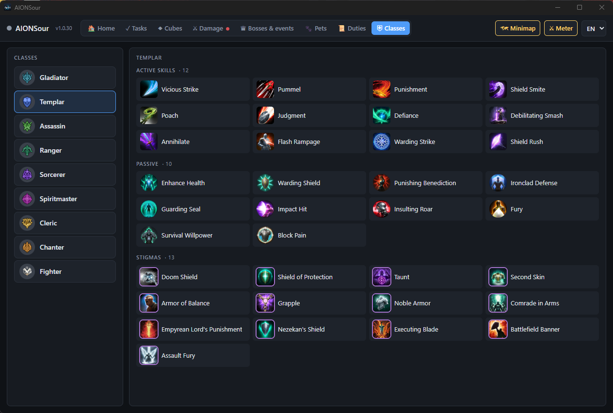

- All 9 classes with their active and passive skills and stigmas, with icons and names in your language.

### Updates

- On launch (and every 6 h) the app checks for a new version and updates with one click, keeping your data.

## Notes

- Fan project, not affiliated with NCSOFT.
